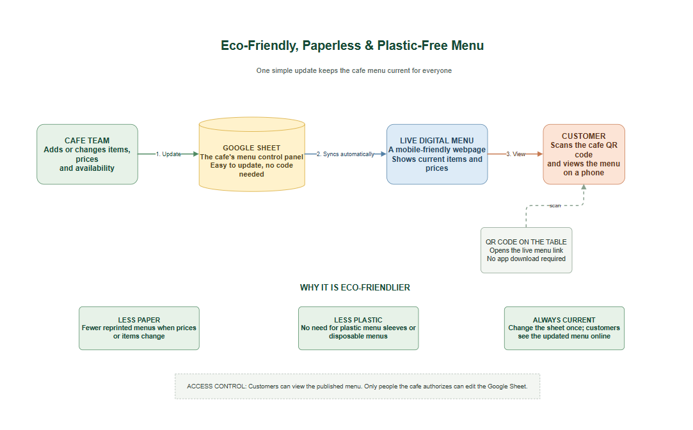

# Eco-Friendly, Paperless & Plastic-Free Menu

A digital cafe menu that helps reduce repeated paper printing and plastic menu sleeves. Cafe staff update menu items, prices, and availability in a Google Sheet; customers scan a QR code to view the current menu on their phones.

## How It Works



1. Cafe staff update the menu in the Google Sheet.
2. The published sheet feeds the live menu webpage.
3. Customers scan the cafe's QR code and view the menu on their phones. No app download is required.
4. Customers send an order with their name and email. The cafe emails UPI payment details, and customers may opt in to receive order and payment updates on WhatsApp. The cafe confirms payment after checking its bank app.

The menu is publicly viewable. Only people authorized by the cafe can edit the Google Sheet.

## Demo

[View the live menu](https://ali-akbar-kolkar.github.io/daily-grind-menu/)

## Diagram Source

[Open or download the editable Draw.io diagram](eco-friendly-paperless-menu.drawio)
[Open the editable ordering and manual-payment flow](cafe-ordering-manual-payment-flow.drawio)

---

# Development notes

Everything below is for whoever maintains this, not for customers.

## How the site is built

No build step, no bundler, no server. It is plain files deployed by GitHub Actions
(`.github/workflows/pages.yml`) to GitHub Pages.

| File | Role |
|------|------|
| `site-config.js` | Published menu URL, currency, Apps Script URL, and public WhatsApp/UPI payment details. |
| `index.html` | Page shell, cart drawer, order form, and the image URL test bench. |
| `script.js` | Fetches the CSV, renders menu cards. |
| `image-urls.js` | Works out a loadable photo URL from whatever the `Image` column holds. |
| `submit-order.js` | Sends order requests to the Apps Script Web App. |
| `order.js` | Cart, totals, customer details, and order state. |
| `style.css` | All styling. |
| `menu-images.csv` | Bundled sample sheet, used when `MENU_CSV_URL` is blank. |
| `payment-backend/Code.gs` | Apps Script order logger, email/WhatsApp sender, and owner payment confirmation. |
| `owner-editor/` | Private Google Apps Script editor so the owner can change the sheet from a phone. |

Scripts load with `defer` in dependency order, so the Apps Script transport and `order.js` are
ready before `script.js` renders the cart buttons. If ordering is not configured, the menu
still renders and checkout explains that orders are unavailable.

PapaParse is loaded from jsDelivr. There is no build step, npm install, or lockfile.
## Ordering: Apps Script and UPI

1. On the first visit, the customer can save their name and email in that browser for faster checkout later, or continue without saving. Saved details can be edited or forgotten at any time. The customer then adds items and submits the cart.
2. The browser posts the order to Apps Script using a stable order ID so a retry cannot create a duplicate row.
3. Apps Script writes the order to the separate `Orders` sheet, emails the customer a **Pay with UPI** HTTPS button, and emails the cafe an order notification. The payment-pending step builds the same payment-page URL using only the stable order ID: `?action=pay&orderId=...`. That page reads the payment amount from the `Orders` sheet and the UPI ID from Apps Script configuration; the browser does not put a customer-editable amount or UPI ID in this payment-page URL. The existing optional local QR/direct UPI link remains available. After submission, the customer can tap **Send order on WhatsApp** to open a prefilled `wa.me` message; the customer must tap **Send** in WhatsApp. This click-to-chat option uses no WhatsApp API or paid service. Set `CAFE_ORDER.whatsappNumber` in `site-config.js` to the cafe's phone number using digits only, including country code and without `+` (for example, `919876543210`); leave it empty to hide the button.
4. The customer taps **Pay with UPI**, then **Open UPI app** on the payment page. The page looks up the order by its ID and does not accept an amount from the URL. If the order is not found—such as during a brief delay while Apps Script writes it—wait a minute and refresh, or use the payment link in the email. The email remains the confirmation of record because the browser cannot read the `no-cors` submission response. Customers can also scan the existing on-page QR from another device; the cafe must verify the payee and amount in its bank app before confirming.
5. After checking the bank app, the owner opens the email link and presses **Confirm payment received**. Apps Script updates the order and emails the customer. For the free click-to-chat flow, the owner replies manually from the WhatsApp Business app with payment details and later confirms payment there. The customer's message opens WhatsApp's 24-hour service window, during which the cafe can reply manually at no charge; the cafe does not send messages automatically through the website.

`CAFE_ORDER.upiId` and `CAFE_ORDER.payeeName` in `site-config.js` control the optional browser QR. Keep the UPI ID synchronized with Apps Script's `CONFIG.UPI_ID`. The payment-page URL contains only the order ID; the page uses the sheet total and configured UPI ID. The optional browser QR amount is calculated from the browser's order and is not trusted payment evidence; the cafe must compare it with the bank app before confirming.

There is no EmailJS integration. The Apps Script Web App URL, public WhatsApp click-to-chat number, public UPI ID, and payee name are configured in `site-config.js`; the private Sheet ID and owner email are configured in Apps Script. Keep the UPI ID in sync with the backend's configured UPI ID. The existing WhatsApp opt-in/API fields remain separate from the free click-to-chat button. Copy-paste owner responses are in [OWNER-REPLY-TEMPLATES.md](OWNER-REPLY-TEMPLATES.md). Follow [the backend setup guide](payment-backend/README.md) only if using the optional API-based notifications.

Customer name and email are stored only in the browser's `localStorage` under a separate profile key; cart resets do not remove them. They are not sent to the server until an order is submitted. The configured cafe click-to-chat number is public by design. The separate WhatsApp API number entered by a customer is not saved in the profile, but is retained with a pending order on the device so a retry can use the same order ID. API-based WhatsApp messages are sent only when the customer explicitly opts in. The click-to-chat message is only shared if the customer chooses **Send** in WhatsApp. Do not save details on a shared browser if other users may access it.

### Browser response behavior

Apps Script content responses redirect to a one-time Google-hosted URL and do not provide a configurable CORS header. The browser therefore sends a `no-cors` request and cannot read the server's result. A resolved fetch only means the request was dispatched: it does not confirm that Apps Script accepted the order, wrote the row, or sent email. The current checkout treats a resolved fetch as success and clears the cart, so a backend validation or email failure can still look successful in the browser. Customers must wait for the order email before paying. If the request fails at the network level, the cart is retained and retry uses the same order ID. WhatsApp API acceptance is recorded separately in the private Orders sheet and does not confirm message delivery.

### Limitations and guard rails

- Payment is not automatically verified. The owner must check the bank app before confirming.
- The displayed amount originates from the order in the customer's browser and can be manipulated. The owner must verify the amount, payee, and order reference against the bank app before confirming payment. The browser cannot confirm Apps Script acceptance; the cafe's email remains the confirmation of record.
- The UPI ID and payee name in `site-config.js` are public because the static site needs them to make the on-page UPI payment link and QR. Do not put private credentials there.
- The Web App is public so the menu can submit orders. It validates inputs, limits item count and quantities, checks the submitted total against item prices, ignores honeypot submissions, and applies a 15-second per-email cooldown, but it is not a full anti-abuse service.
- Menu prices and quantities originate in the browser and can be manipulated. The cafe should verify the total against the order email and bank transaction.
- Apps Script and Gmail have daily quotas. Monitor usage if order volume grows.
- The separate WhatsApp API notification feature requires customer opt-in and approved utility templates. The `wa.me` click-to-chat button does not use that API and works independently; the email flow remains available either way.
- `index.html?demo=1` exercises the checkout UI without submitting an order.

### Current repository status

- `node order-test.js` passes. It checks the local checkout flow, including the
  no-CORS transport, click-to-chat URL, and order-specific payment-page URL, but cannot
  verify that the live Apps Script deployment accepted an order or delivered
  email.
- `node smoke-test.js` currently cannot start because the referenced
  `menu-images.csv` file is not present. The configured remote CSV may still
  allow the deployed menu to work; restore the sample or update the test and
  local fallback before relying on local-sample mode.
- `payment-backend/Code.gs` is a deployment template with placeholder
  configuration. Keep the configured Apps Script source private and verify the
  active deployment version in Google Apps Script; a local source edit does not
  update an existing Web App deployment.
- The repository checks do not test Google Sheet permissions, Apps Script
  authorization/quotas, email delivery, WhatsApp setup, or real UPI payment.
  Verify those in the corresponding Google/Meta services with a controlled
  test order.
- For a manual click-to-chat test, set `CAFE_ORDER.whatsappNumber` to a test
  number and open `index.html?demo=1` on a phone. Submit the demo order, tap
  **Send order on WhatsApp**, review the prefilled text, then tap **Send** in
  WhatsApp. Demo mode does not submit the order to Apps Script.
- The on-page QR uses the pinned `qrcode-generator` 1.4.4 script from cdnjs.
  QR generation runs in the browser; the email QR continues to use the separate
  existing Apps Script QR-image flow.
- To manually test the on-page payment step, open `index.html?demo=1` on a
  phone, submit a demo order, tap **Open UPI app** or the QR, and try **Download
  QR (JPG)**. The downloaded JPG contains the same order-specific UPI payment
  link.
  To test QR scanning, open the same demo order on one device and scan its QR
  from a second device. Do not authorize a real payment during this test.

## Deployment

`pages.yml` checks out the repo, optionally rewrites the `window.MENU_CSV_URL` line in
`site-config.js` from the `MENU_CSV_URL` repository variable, then publishes. Configure the
Apps Script `/exec` URL in `site-config.js` before deploying the integrated checkout.

It replaces **only that one line**, on purpose. An earlier version rewrote the whole file, which
silently deleted the currency and the entire ordering config on every deploy.

If the `MENU_CSV_URL` variable is not set, the URL committed in `site-config.js` is used as-is, so
the site still deploys correctly. If the line is missing entirely the deploy fails loudly rather
than publishing a broken config.

## Running the checks

```
node smoke-test.js
node order-test.js
```

- `smoke-test.js` — 83 checks on file-ID extraction, URL candidates, card rendering, the tally,
  the parsers, the fetch failure paths, and that the developer test bench stays hidden unless
  `?bench=1` is set.
- `order-test.js` — cart validation, Apps Script payloads, no-CORS transport, stable IDs on retries,
  pending-order recovery, the honeypot, and checks that no EmailJS or customer-side payment claim remains.

Both run the real files in a `vm` sandbox against a stub DOM and fake `localStorage`; no live Apps Script
deployment or network access is needed.

## Owner editor

`owner-editor/` is a private Apps Script web app the owner opens on their phone to edit the sheet
and save straight back to Drive. Add `?demo=1` to `owner-editor/Index.html` to try it against
in-memory rows. See [`owner-editor/README.md`](owner-editor/README.md).

Note that this repository is public, so the Apps Script server code and the sheet's column
structure are readable by anyone. Keeping the editor source private would need a separate private
repository.
